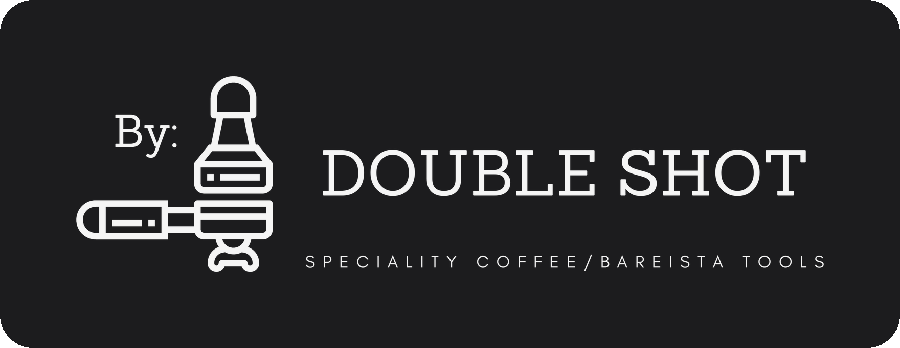
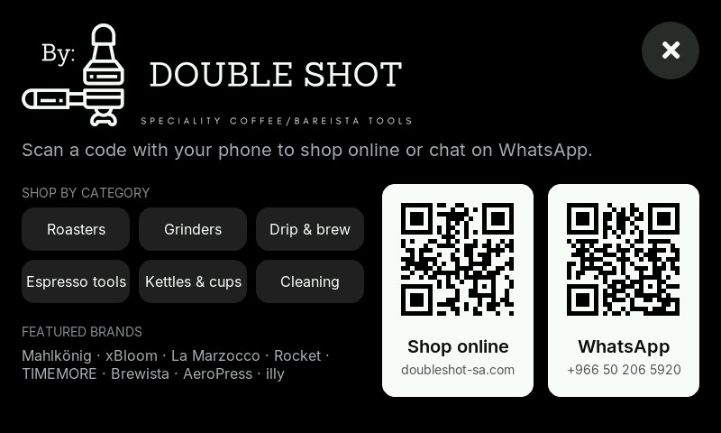

<div dir="rtl">

<p align="center">
  <b>العربية</b> · <a href="README.md">English</a> · <a href="README.zh-CN.md">简体中文</a>
</p>

<div align="center">



# ☕ xBloom Panel من Double Shot

**شاشة لمس لجهاز xBloom Studio: الوصفات والتحضير والمطحنة والميزان في متناول يدك، بالإنجليزية أو العربية.**

[](https://github.com/2B-4G10/Xbloom-Panel/releases)
[](https://github.com/2B-4G10/Xbloom-Panel/releases/latest)
[](https://github.com/2B-4G10/Xbloom-Panel/releases/latest)
[](https://www.patreon.com/c/Dossary)

</div>

---

## 👋 ما هي؟

شاشة لمس توضع بجانب جهاز **xBloom Studio** وتتحكم فيه عبر Bluetooth. وهي شاشة **Elecrow CrowPanel Advance 4.3″** مثبّت عليها هذا البرنامج الثابت.

- ☕ **وصفاتك** من حسابك في xBloom، مع مشهد تحضير حي بأسلوب المصفوفة النقطية
- 🍓 **8 وصفات للبداية**، منها 🍓 Berry Bomb و🍫 Chocolate Hug و🧊 Iced Sunrise
- ✏️ **عدّل الوصفات على الشاشة**، وتُزامَن التعديلات مع حسابك
- ⚙️ التحكم في **المطحنة والمحضّر والميزان**
- 🌐 **بالإنجليزية أو العربية**، مع أرقام عربية أو إنجليزية
- 😋 **كل الرموز التعبيرية** بالألوان
- 🔄 **تحدّث نفسها عبر Wi-Fi**: بلمسة واحدة، أو تلقائيًا بالكامل
- 🕰️ **ساعة أثناء الخمول**، ووضع استعداد صامت بإضاءة خافتة
- 🛍️ **تبويب Double Shot** مع رموز QR للمتجر

<div align="center">
  
  
</div>

> مشروع غير رسمي: لا علاقة له بشركة xBloom.

**تحتاج إلى:** شاشة CrowPanel **Advance** مقاس 4.3″ (800×480) من [AliExpress](https://a.aliexpress.com/_c3srIHtH) أو [Elecrow](https://www.elecrow.com/crowpanel-advance-4-3-hmi-esp32-800x480-ai-display-ips-touch-artificial-intelligent-screen.html)، وكيبل USB-C ينقل البيانات.

---

## 🚀 التثبيت

**ثبّتها مرة واحدة بالكيبل، وبعدها تحدّث نفسها عبر Wi-Fi.** وصفاتك وإعداداتك تبقى دائمًا.

وصّل اللوحة بالكمبيوتر والصق سطرًا واحدًا:

**🍎 Mac** (في Terminal):

<div dir="ltr">

```bash
curl -fsSL https://raw.githubusercontent.com/2B-4G10/Xbloom-Panel/main/scripts/flash-mac.sh -o /tmp/xbp.sh && bash /tmp/xbp.sh
```

</div>

**🪟 Windows** (في PowerShell):

<div dir="ltr">

```powershell
irm https://raw.githubusercontent.com/2B-4G10/Xbloom-Panel/main/scripts/flash-windows.ps1 -OutFile "$env:TEMP\xbp.ps1"; powershell -ExecutionPolicy Bypass -File "$env:TEMP\xbp.ps1"
```

</div>

<details>
<summary>⚙️ الخيارات</summary>

اضبط الخيار قبل الأمر: في Mac `XBP_BACKUP=1 bash …` · في Windows `$env:XBP_BACKUP="1"`

| الخيار | ماذا يفعل |
|---|---|
| `XBP_BACKUP=1` | يأخذ نسخة احتياطية من اللوحة إلى `Desktop/xBloom-backups` أولًا |
| `XBP_FRESH=1` | يمسح كل شيء أيضًا (يُعاد ضبط Wi-Fi وتسجيل الدخول إلى xBloom) |
| `XBP_PORT=…` | يستخدم هذا المنفذ (`/dev/cu.wchusbserial110`، `COM5`) |
| `XBP_BAUD=115200` | يستخدم سرعة تثبيت واحدة (عادةً يجرّب 921600، ثم 460800، ثم 115200) |
| `XBP_BUILD=1` | يبني البرنامج الثابت من المصدر بدل تنزيله (من 30 إلى 60 دقيقة، ويثبّت Python وأدوات البناء) |

</details>

<details>
<summary>🌐 لا تريد الطرفية؟ ثبّتها من المتصفح</summary>

1. نزّل [**ملف USB**](https://github.com/2B-4G10/Xbloom-Panel/releases/latest/download/xbloom-panel-doubleshot-FULL-USB-ONLY.bin) ووصّل اللوحة.
2. في **Chrome** أو **Edge**، افتح **https://espressif.github.io/esptool-js/**
3. اجعل Baudrate على `115200` ← **Connect** ← اختر منفذ اللوحة.
4. اجعل Flash Address على `0x0` ← اختر الملف ← **Program**، ثم اضغط **RESET**.

⛔ هذا الملف للتثبيت عبر USB فقط.
</details>

---

## ⚙️ بعد التثبيت

1. **الإعدادات ← الواي فاي** (Settings → Wi-Fi): اختر شبكتك.
2. **الإعدادات ← حساب xBloom** (Settings → xBloom account): سجّل الدخول بالبريد وكلمة المرور اللذين تستخدمهما في تطبيق xBloom.
3. شغّل جهاز xBloom Studio، وستتصل به اللوحة تلقائيًا.
4. **الإعدادات ← اللغة** (Settings → Language): الإنجليزية أو العربية.

---

## 🔄 التحديثات

عند صدور إصدار جديد تسألك اللوحة. اضغط **موافق** للتثبيت، أو اختر **حدّث تلقائيًا دائمًا** وانسَ الأمر. يُتحقَّق من كل تنزيل، وإذا تعذّر تشغيل أي تحديث، تعود اللوحة تلقائيًا إلى الإصدار السابق.

يمكنك تغيير ذلك في أي وقت من **الإعدادات ← تحديث البرنامج**.

---

## 🧯 المساعدة

<details>
<summary><b>الكمبيوتر لا يرى اللوحة</b></summary>

استخدم كيبل بيانات موصولًا بالكمبيوتر مباشرة (دون موزّع)، وثبّت تعريف USB:
- **Mac:** [تعريف WCH](https://www.wch-ic.com/downloads/CH34XSER_MAC_ZIP.html)، ثم اسمح به من **System Settings → General → Login Items & Extensions → Driver Extensions**.
- **Windows:** [CH341SER](https://www.wch-ic.com/downloads/CH341SER_EXE.html).

ثم افصل اللوحة ووصّلها من جديد.
</details>

<details>
<summary><b>عالقة عند «Connecting…» أو «serial noise»</b></summary>

اضغط مطوّلًا على **BOOT**، واضغط **RESET** ضغطة واحدة، ثم اترك **BOOT** وحاول مجددًا. إذا كان الكيبل طويلًا، استخدم السرعة `57600`.
</details>

<details>
<summary><b>توقّف التثبيت بالأمر الواحد</b></summary>

الصق الأمر نفسه مرة أخرى. فهو يتحقق من كل تنزيل ويبدأ من جديد في كل مرة. إذا لم يتمكن من التواصل مع اللوحة، فأغلق البرامج الأخرى التي تستخدمها (Arduino IDE وبرامج مراقبة المنفذ التسلسلي)، أو اضغط مطوّلًا على **BOOT**، واضغط **RESET** ضغطة واحدة، ثم اترك **BOOT** وحاول مجددًا.
</details>

<details>
<summary><b>↩️ استعادة نسخة احتياطية</b></summary>

استخدم طريقة **التثبيت من المتصفح** مع ملف النسخة الاحتياطية (من `Desktop/xBloom-backups`) على العنوان `0x0`.
</details>

<details>
<summary><b>🤖 كيف تبقى محدّثة</b></summary>

كل أسبوع: يوم الأحد يُفحص [المشروع الأصلي](https://github.com/Mesh-one/Xbloom-panel) بحثًا عن تغييرات تستحق المراجعة، ويومَي الاثنين والثلاثاء تُختبر تحديثات الأدوات وتُطبَّق، ويوم الأربعاء يُنشر [إصدار جديد](https://github.com/2B-4G10/Xbloom-Panel/releases) إذا تغيّر أي شيء (انظر [سجل التغييرات](CHANGELOG.md)).
</details>

---

<div align="center">

---

صُنع بحب ☕ من **Double Shot** · © Double Shot، جميع الحقوق محفوظة ([`LICENSE`](LICENSE)) · الشكر وتراخيص الأطراف الثالثة: `THIRD_PARTY_NOTICES.md`

<br>

### 🇸🇦 ❤️ ☕

**من صنع: [@i_2B_4G10](https://t.me/i_2B_4G10)**

[](https://www.patreon.com/c/Dossary)

</div>

</div>
