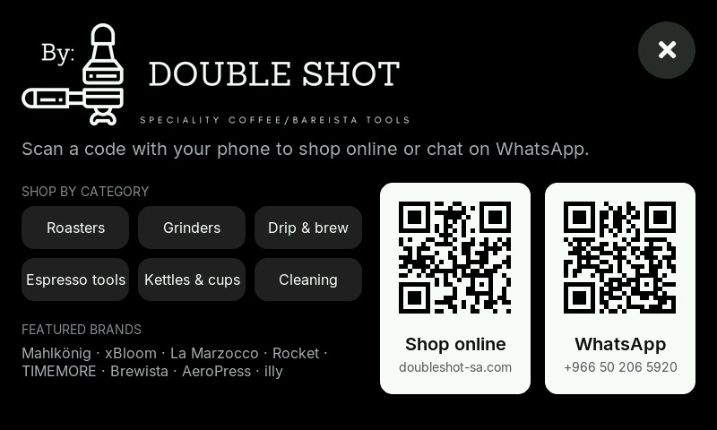

<div align="center">

<picture>
  <source media="(prefers-color-scheme: dark)" srcset="docs/images/logo-dark.png">
  
</picture>

# ☕ xBloom Panel · Double Shot Edition

**A touchscreen for your xBloom Studio, with the Double Shot logo and store page built in.**

</div>

---

## 👋 What is it?

Firmware for an **Elecrow CrowPanel Advance 4.3″** touchscreen that sits next to your **xBloom Studio** and controls it over Bluetooth. It covers recipes, brewing, grinder and scale.

This edition adds:

| | |
|---|---|
| 🚀 **Double Shot boot logo** | Shown every time the panel starts. |
| 🛍️ **Double Shot tab** | Full-screen store page with QR codes for [doubleshot-sa.com](https://doubleshot-sa.com) and WhatsApp. Close it with the big ✕. |

<div align="center">
  
  
</div>

> Unofficial project, not affiliated with xBloom. Based on [xBloom Panel by Mansour Alshekhi](https://github.com/Mesh-one/Xbloom-panel).

---

## 🧺 What you need

- 🖥️ **Elecrow CrowPanel Advance 4.3″** (the **Advance** 800×480 model): [AliExpress](https://a.aliexpress.com/_c3srIHtH) · [Elecrow](https://www.elecrow.com/crowpanel-advance-4-3-hmi-esp32-800x480-ai-display-ips-touch-artificial-intelligent-screen.html)
- 🔌 **A USB-C cable that carries data.** Charge-only cables won't work.
- 🔑 **Access to this repository.** It is private, so sign in to GitHub with an account that has been given access.

---

## 📦 The two firmware files

Download them from the [**latest release**](https://github.com/2B-4G10/Xbloom-Panel/releases/latest). Each name tells you how to install it:

| File | Install it with | Your settings |
|---|---|---|
| 🛜 `xbloom-panel-doubleshot-UPDATE-WiFi-or-USB.bin` | **Wi-Fi** from the panel's settings (Method 1) | ✅ Kept |
| 🔌 `xbloom-panel-doubleshot-FULL-USB-ONLY.bin` | **USB cable only** (Method 2) | ⚠️ Wi-Fi and xBloom login reset |

> ⛔ **Never upload the FULL-USB-ONLY file on the Wi-Fi update page.** It only works over USB.

---

## 🚀 How to install (pick one)

### 1️⃣ Wi-Fi update: easiest, if the panel already runs xBloom Panel

1. Download **`xbloom-panel-doubleshot-UPDATE-WiFi-or-USB.bin`** from the [latest release](https://github.com/2B-4G10/Xbloom-Panel/releases/latest) to your phone or computer.
2. On the panel, go to **Settings → Software update**.
3. Open the address the panel shows (on a phone or computer on the same Wi-Fi), choose the file, and upload it.
4. The panel restarts with the new firmware. Your settings stay. 🎉

### 2️⃣ USB with the `.bin` file: no software to install

Use this for a new panel, or to recover one.

1. Download **`xbloom-panel-doubleshot-FULL-USB-ONLY.bin`** from the [latest release](https://github.com/2B-4G10/Xbloom-Panel/releases/latest).
2. Connect the panel to your computer with the USB-C cable.
3. In **Chrome** or **Edge**, open Espressif's web flasher: **https://espressif.github.io/esptool-js/**
4. Set **Baudrate** to `115200`, click **Connect**, and pick the panel's port. On a Mac it's named `wchusbserial…`.
5. Set **Flash Address** to `0x0`, choose the **FULL-USB-ONLY** file, and click **Program**.
6. When it finishes, press the panel's **RESET** button, then set up Wi-Fi and your xBloom account again.

> 💡 **No port shows up?** The panel's USB chip (WCH CH34x) needs a driver on some computers. **Mac:** install the [WCH driver](https://www.wch-ic.com/downloads/CH34XSER_MAC_ZIP.html), then turn it on in **System Settings → General → Login Items & Extensions → Driver Extensions**. **Windows:** install [CH341SER](https://www.wch-ic.com/downloads/CH341SER_EXE.html). Then replug the panel.

### 3️⃣ One command: builds from source and backs up first

This method installs everything it needs, **backs up the panel**, builds the latest code and flashes it. Your settings are kept. The first run takes 30–60 minutes, mostly waiting ☕.

**🍎 Mac.** Open **Terminal** and paste:

```bash
brew install gh && gh auth login && gh repo clone 2B-4G10/Xbloom-Panel ~/Xbloom-Panel && bash ~/Xbloom-Panel/scripts/flash-mac.sh
```

**🪟 Windows.** Open **PowerShell** and paste:

```powershell
winget install -e --id GitHub.cli --accept-source-agreements --accept-package-agreements; winget install -e --id Git.Git --accept-source-agreements --accept-package-agreements; $env:Path = [Environment]::GetEnvironmentVariable('Path','Machine') + ';' + [Environment]::GetEnvironmentVariable('Path','User'); gh auth login; gh repo clone 2B-4G10/Xbloom-Panel "$HOME\Xbloom-Panel"; powershell -ExecutionPolicy Bypass -File "$HOME\Xbloom-Panel\scripts\flash-windows.ps1"
```

What happens:
- `gh auth login` signs you in to GitHub once. Choose **GitHub.com → HTTPS → Yes → Login with a web browser**.
- The script then checks and installs everything it needs: Python, the build tools, esptool and the USB driver. It explains each step as it goes.
- It saves a **backup** of the panel to `Desktop/xBloom-backups` before changing anything.
- It flashes the new firmware, and also leaves the Wi-Fi update file on your Desktop.

On a Mac, if `brew` isn't found, install [Homebrew](https://brew.sh) first.

**To run it again later:** Mac: `bash ~/Xbloom-Panel/scripts/flash-mac.sh` · Windows: `powershell -ExecutionPolicy Bypass -File "$HOME\Xbloom-Panel\scripts\flash-windows.ps1"`

<details>
<summary>⚙️ Options for the command method</summary>

Put these before the command. On a Mac: `XBP_NO_BACKUP=1 bash …`. On Windows, run e.g. `$env:XBP_NO_BACKUP="1"` first.

| Option | Effect |
|---|---|
| `XBP_BUILD_ONLY=1` | Only build the Wi-Fi update file; don't touch the panel |
| `XBP_NO_BACKUP=1` | Skip the backup |
| `XBP_PORT=…` | Use a specific port (`/dev/cu.wchusbserial110`, `COM5`) |
| `XBP_BAUD=…` | Serial speed (default `115200`; try `57600` with a long cable) |

</details>

---

## ⚙️ After installing

1. **Settings → Wi-Fi:** pick your network.
2. **Settings → xBloom account:** sign in with your xBloom app email and password.
3. Turn on the xBloom Studio. The panel connects by itself over Bluetooth.

---

## 🧯 Help

<details>
<summary><b>The computer doesn't see the panel</b></summary>

Use a data cable, plug straight into the computer (no hub), and install the USB driver (see the 💡 tip in Method 2). On a Mac, `ls /dev/cu.*` should list a `cu.wchusbserial…` port.
</details>

<details>
<summary><b>"Invalid head of packet … serial noise"</b></summary>

The serial speed is too high. Use `115200`, or `57600` with a shorter cable.
</details>

<details>
<summary><b>Stuck at "Connecting…"</b></summary>

Hold **BOOT**, tap **RESET**, release **BOOT**, and try again. Press **RESET** once after flashing.
</details>

<details>
<summary><b>↩️ Restore your backup</b></summary>

Use **Method 2**, but choose your backup file (in `Desktop/xBloom-backups`) instead of the FULL-USB-ONLY file, at address `0x0`. The panel returns exactly to how it was, settings included.
</details>

---

## 🤖 How it stays up to date

| When | What happens automatically |
|---|---|
| **Daily** | New fixes and features from the [original project](https://github.com/Mesh-one/Xbloom-panel) are imported. They're built first and only added if the firmware builds. If they clash with the Double Shot changes, nothing is changed and GitHub emails you that the sync needs a hand. |
| **Monday** | Dependabot updates the build automation, and the ESP32 platform is updated with its matching build tool. Each update is test-built first and added only if it passes. A platform version that doesn't build yet is skipped and noted in `.github/essentials-hold.txt`. |
| **Wednesday** | If anything changed that week, a new [release](https://github.com/2B-4G10/Xbloom-Panel/releases) is published with both `.bin` files and a [changelog](CHANGELOG.md). |

<details>
<summary>🧑‍💻 Building by hand</summary>

```bash
python3 -m venv ~/.platformio/penv                              # Python 3.10–3.14
~/.platformio/penv/bin/pip install -r requirements-build.txt   # build tools
~/.platformio/penv/bin/pio run                                 # first build takes a while
```

The boot logo is `src/boot_logo.c`, the store page is `build_store()` in `src/ui.cpp`, and `sim/` previews the screens on a computer.
</details>

---

<details>
<summary>🇸🇦 <b>بالعربي باختصار</b></summary>

**ملفات البرنامج** (من صفحة [آخر إصدار](https://github.com/2B-4G10/Xbloom-Panel/releases/latest)):
- **`UPDATE-WiFi-or-USB`**: للتحديث عن طريق الواي فاي من **الإعدادات ← تحديث البرنامج**. إعداداتك تبقى.
- **`FULL-USB-ONLY`**: بالكيبل فقط (أول تثبيت أو إصلاح). ⛔ لا ترفعه من صفحة تحديث الواي فاي. يمسح إعدادات الواي فاي والحساب.

**التثبيت بالكيبل بدون برامج:** افتح https://espressif.github.io/esptool-js/ في كروم، اختر السرعة `115200` ثم **Connect**، والعنوان `0x0`، وملف **FULL-USB-ONLY**، ثم **Program**.

**أو بأمر واحد** (يسوي نسخة احتياطية ويبني ويثبّت): انسخ أمر الماك أو الويندوز من الطريقة 3 فوق.
</details>

<div align="center">

---

Made with ☕ by **Double Shot** · MIT licensed (`LICENSE`) · third-party code: `THIRD_PARTY_NOTICES.md`

</div>
