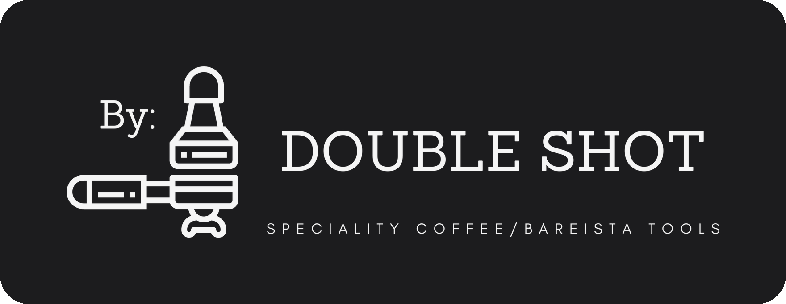

<p align="center">
  <a href="README.ar.md">العربية</a> · <a href="README.md">English</a> · <b>简体中文</b>
</p>

<div align="center">



# ☕ xBloom Panel（Double Shot 出品）

**为你的 xBloom Studio 配一块触摸屏：配方、冲煮、磨豆机和电子秤尽在指尖，支持英语或阿拉伯语。**

[](https://github.com/2B-4G10/Xbloom-Panel/releases)
[](https://github.com/2B-4G10/Xbloom-Panel/releases/latest)
[](https://github.com/2B-4G10/Xbloom-Panel/releases/latest)
[](https://www.patreon.com/c/Dossary)

</div>

---

## 👋 这是什么？

一块放在 **xBloom Studio** 旁边、通过 Bluetooth 控制它的触摸屏。硬件是 **Elecrow CrowPanel Advance 4.3″**，刷入了本固件。

- ☕ **你的配方**，直接来自你的 xBloom 账户，冲煮时还有实时点阵动画
- 🍓 **8 款入门配方**，包括 🍓 Berry Bomb、🍫 Chocolate Hug 和 🧊 Iced Sunrise
- ✏️ **直接在屏幕上编辑配方**，并同步回你的账户
- ⚙️ **磨豆机、冲煮器和电子秤**控制
- 🌐 **英语或阿拉伯语**界面，数字可显示为阿拉伯文写法或西文写法
- 😋 **所有表情符号**都以彩色显示
- 🔄 **通过 Wi-Fi 自行更新**：一键更新，或完全自动
- 🕰️ **闲置时显示时钟**，以及静音、调暗的待机模式
- 🛍️ **Double Shot 标签页**，附带商店二维码

<div align="center">
  
  
</div>

> 非官方项目：与 xBloom 无任何隶属关系。

**你需要：** 一块 CrowPanel **Advance** 4.3″（800×480），可在 [AliExpress](https://a.aliexpress.com/_c3srIHtH) 或 [Elecrow](https://www.elecrow.com/crowpanel-advance-4-3-hmi-esp32-800x480-ai-display-ips-touch-artificial-intelligent-screen.html) 购买，以及一根支持数据传输的 USB-C 线。

---

## 🚀 安装

**只需用数据线刷写一次，之后它会通过 Wi-Fi 自行更新。** 你的配方和设置始终保留。

将面板连接到电脑，然后粘贴一行命令：

**🍎 Mac**（Terminal）：

```bash
curl -fsSL https://raw.githubusercontent.com/2B-4G10/Xbloom-Panel/main/scripts/flash-mac.sh -o /tmp/xbp.sh && bash /tmp/xbp.sh
```

**🪟 Windows**（PowerShell）：

```powershell
irm https://raw.githubusercontent.com/2B-4G10/Xbloom-Panel/main/scripts/flash-windows.ps1 -OutFile "$env:TEMP\xbp.ps1"; powershell -ExecutionPolicy Bypass -File "$env:TEMP\xbp.ps1"
```

<details>
<summary>⚙️ 选项</summary>

在命令前设置：Mac `XBP_BACKUP=1 bash …` · Windows `$env:XBP_BACKUP="1"`

| 选项 | 作用 |
|---|---|
| `XBP_BACKUP=1` | 先将面板备份到 `Desktop/xBloom-backups` |
| `XBP_FRESH=1` | 同时清除所有数据（重置 Wi-Fi 和 xBloom 登录） |
| `XBP_PORT=…` | 使用指定端口（`/dev/cu.wchusbserial110`、`COM5`） |
| `XBP_BAUD=115200` | 只使用一种刷写速度（默认依次尝试 921600、460800、115200） |
| `XBP_BUILD=1` | 从源代码编译固件，而不是直接下载（需要 30–60 分钟，会安装 Python 和编译工具） |

</details>

<details>
<summary>🌐 不想用终端？在浏览器中刷写</summary>

1. 下载 [**USB 文件**](https://github.com/2B-4G10/Xbloom-Panel/releases/latest/download/xbloom-panel-doubleshot-FULL-USB-ONLY.bin)，并连接面板。
2. 在 **Chrome** 或 **Edge** 中打开 **https://espressif.github.io/esptool-js/**
3. Baudrate 设为 `115200` → **Connect** → 选择面板的端口。
4. Flash Address 设为 `0x0` → 选择文件 → **Program**，然后按 **RESET**。

⛔ 此文件仅用于 USB 刷写。
</details>

---

## ⚙️ 安装之后

1. **Settings → Wi-Fi**（设置 → Wi-Fi）：选择你的网络。
2. **Settings → xBloom account**（设置 → xBloom 账户）：用你在 xBloom App 中使用的邮箱和密码登录。
3. 打开 xBloom Studio，面板会自动连接。
4. **Settings → Language**（设置 → 语言）：选择英语或阿拉伯语。

---

## 🔄 更新

有新版本时，面板会询问你。点击 **Ok** 进行安装，或选择 **Always Update Automatically**（始终自动更新），之后就不用再操心了。每次下载都会经过校验；如果某次更新后无法启动，面板会自动回退到上一个版本。

你可以随时在 **Settings → Software update**（设置 → 软件更新）中更改此设置。

---

## 🧯 帮助

<details>
<summary><b>电脑识别不到面板</b></summary>

请使用数据线直接连接电脑（不要经过集线器），并安装 USB 驱动：
- **Mac：** 安装 [WCH 驱动](https://www.wch-ic.com/downloads/CH34XSER_MAC_ZIP.html)，然后在 **System Settings → General → Login Items & Extensions → Driver Extensions** 中允许它。
- **Windows：** [CH341SER](https://www.wch-ic.com/downloads/CH341SER_EXE.html)。

然后拔下面板，再重新插上。
</details>

<details>
<summary><b>卡在“Connecting…”或出现“serial noise”</b></summary>

按住 **BOOT**，点按一下 **RESET**，松开 **BOOT**，然后重试。如果数据线较长，请使用速度 `57600`。
</details>

<details>
<summary><b>一键安装中途停止了</b></summary>

再次粘贴同一条命令即可。它每次都会校验所有下载，并从头开始。如果无法与面板通信，请关闭其他正在占用它的程序（Arduino IDE、串口监视器），或者按住 **BOOT**，点按一下 **RESET**，松开 **BOOT**，然后重试。
</details>

<details>
<summary><b>↩️ 恢复备份</b></summary>

使用 **在浏览器中刷写** 的方法，选择你的备份文件（位于 `Desktop/xBloom-backups`），地址设为 `0x0`。
</details>

<details>
<summary><b>🤖 如何保持最新</b></summary>

每周：周日检查[原始项目](https://github.com/Mesh-one/Xbloom-panel)是否有需要审阅的改动，周一和周二测试并应用工具更新，周三如有任何变化就发布[新版本](https://github.com/2B-4G10/Xbloom-Panel/releases)（参见[更新日志](CHANGELOG.md)）。
</details>

---

<div align="center">

---

由 **Double Shot** 用 ☕ 精心打造 · © Double Shot，保留所有权利（[`LICENSE`](LICENSE)）· 致谢与第三方许可：`THIRD_PARTY_NOTICES.md`

<br>

### 🇸🇦 ❤️ ☕

**作者：[@i_2B_4G10](https://t.me/i_2B_4G10)**

[](https://www.patreon.com/c/Dossary)

</div>
